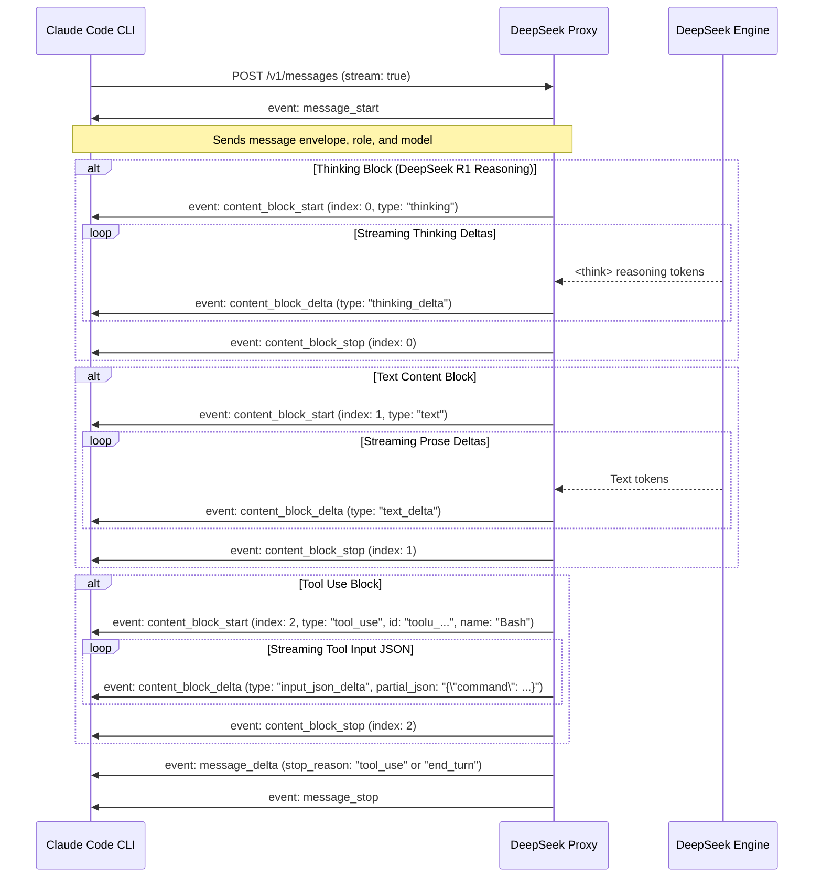

# Claude Code & Anthropic Messages API — Complete Architecture & Specification

> **Target Objective:** Build a bulletproof proxy adapter enabling **Claude Code** (`@anthropic-ai/claude-code`) to run seamlessly on top of **DeepSeek (R1 / V3)** alongside our existing Codex Responses Proxy.

---

## 1. Executive Summary

Claude Code is Anthropic's official agentic terminal coding assistant. Unlike OpenAI Codex (which uses the `/v1/responses` API or Chat Completions), Claude Code communicates exclusively via the **Anthropic Messages API (`POST /v1/messages`)** with Server-Sent Events (SSE) streaming and strict JSON `tool_use` / `tool_result` content blocks.

This document compiles the exhaustive protocol specification, exact tool schemas extracted directly from the official `@anthropic-ai/claude-code@2.1.316` package (`sdk-tools.d.ts`), the SSE streaming event lifecycle, and the architectural design required to bridge DeepSeek to Claude Code without regression or stability issues.

---

## 2. Claude Code Connection & Environment

### 2.1 Directing Claude Code to a Custom Proxy
Claude Code natively supports custom API gateways via standard environment variables:

```bash
# Point Claude Code to our local / LAN proxy
export ANTHROPIC_BASE_URL="http://192.168.1.6:18789"

# Or configure permanently in ~/.claude/settings.json
cat << 'EOF' > ~/.claude/settings.json
{
  "env": {
    "ANTHROPIC_BASE_URL": "http://192.168.1.6:18789"
  }
}
EOF
```

### 2.2 Authentication Flow
Claude Code sends authentication in one of two headers:
1. `x-api-key: <token>` (Standard API key header)
2. `authorization: Bearer <token>` (Bearer token / OAuth token)

The proxy must accept either header and map it to our internal `tokenPool`.

### 2.3 Verification Command
Running `/status` inside Claude Code inspects and prints:
- Active model (`claude-3-7-sonnet-20250219` or custom alias)
- **Anthropic base URL** (must reflect `http://192.168.1.6:18789`)
- Working directory and auth status

---

## 3. Anthropic Messages API Specification (`POST /v1/messages`)

### 3.1 HTTP Headers
```http
POST /v1/messages HTTP/1.1
Host: 192.168.1.6:18789
Content-Type: application/json
x-api-key: sk-proxy-...
anthropic-version: 2023-06-01
anthropic-beta: prompt-caching-2024-07-31,output-128k-2025-02-19,thinking-2025-02-19
```

### 3.2 Request Body Structure
```json
{
  "model": "claude-3-7-sonnet-20250219",
  "max_tokens": 8192,
  "system": [
    {
      "type": "text",
      "text": "You are Claude Code, Anthropic's official CLI...",
      "cache_control": { "type": "ephemeral" }
    }
  ],
  "messages": [
    {
      "role": "user",
      "content": "Check git status and compile the project"
    },
    {
      "role": "assistant",
      "content": [
        { "type": "text", "text": "I will inspect git status first." },
        {
          "type": "tool_use",
          "id": "toolu_01A9...",
          "name": "Bash",
          "input": { "command": "git status" }
        }
      ]
    },
    {
      "role": "user",
      "content": [
        {
          "type": "tool_result",
          "tool_use_id": "toolu_01A9...",
          "content": "On branch main\nnothing to commit",
          "is_error": false
        }
      ]
    }
  ],
  "tools": [
    {
      "name": "Bash",
      "description": "Execute a bash command in the terminal",
      "input_schema": {
        "type": "object",
        "properties": {
          "command": { "type": "string" },
          "timeout": { "type": "number" },
          "description": { "type": "string" }
        },
        "required": ["command"]
      }
    }
  ],
  "stream": true,
  "thinking": {
    "type": "enabled",
    "budget_tokens": 4096
  }
}
```

---

## 4. Server-Sent Events (SSE) Streaming Lifecycle

Claude Code mandates real-time SSE streaming (`text/event-stream`). The proxy must emit events in the exact sequence expected by Anthropic client SDKs:



### 4.1 Exhaustive Event Formats

#### 1. `message_start`
```
event: message_start
data: {"type":"message_start","message":{"id":"msg_01Xj...","type":"message","role":"assistant","model":"claude-3-7-sonnet-20250219","content":[],"stop_reason":null,"stop_sequence":null,"usage":{"input_tokens":1250,"output_tokens":1}}}

```

#### 2. `content_block_start` (Text, Thinking, or Tool Use)
- **Text:**
  ```
  event: content_block_start
  data: {"type":"content_block_start","index":0,"content_block":{"type":"text","text":""}}
  ```
- **Thinking (Native R1 Reasoning Display in Claude Code Terminal!):**
  ```
  event: content_block_start
  data: {"type":"content_block_start","index":0,"content_block":{"type":"thinking","thinking":""}}
  ```
- **Tool Use:**
  ```
  event: content_block_start
  data: {"type":"content_block_start","index":1,"content_block":{"type":"tool_use","id":"toolu_01AbCdEf...","name":"Bash","input":{}}}
  ```

#### 3. `content_block_delta`
- **Text Delta:**
  ```
  event: content_block_delta
  data: {"type":"content_block_delta","index":0,"delta":{"type":"text_delta","text":"I am reviewing the codebase."}}
  ```
- **Thinking Delta:**
  ```
  event: content_block_delta
  data: {"type":"content_block_delta","index":0,"delta":{"type":"thinking_delta","thinking":"The user wants to find..."}}
  ```
- **Input JSON Delta:**
  ```
  event: content_block_delta
  data: {"type":"content_block_delta","index":1,"delta":{"type":"input_json_delta","partial_json":"{\"command\":\"ls -la\"}"}}
  ```

#### 4. `content_block_stop`
```
event: content_block_stop
data: {"type":"content_block_stop","index":0}

```

#### 5. `message_delta`
```
event: message_delta
data: {"type":"message_delta","delta":{"stop_reason":"tool_use","stop_sequence":null},"usage":{"output_tokens":85}}

```
*(Note: `stop_reason` must be `"tool_use"` when tool calls are emitted, or `"end_turn"` when the turn finishes with text/deliverables).*

#### 6. `message_stop`
```
event: message_stop
data: {"type":"message_stop"}

```

---

## 5. Claude Code Official Tools Specification

Extracted directly from `@anthropic-ai/claude-code@2.1.316` (`sdk-tools.d.ts`):

### 5.1 `Bash` Tool
Executes terminal commands with support for timeouts and descriptive labels:
```typescript
interface BashInput {
  command: string;          // Required: The command to execute
  timeout?: number;        // Optional: Max milliseconds (default 600000)
  description?: string;    // Optional: Concise description in active voice
  run_in_background?: boolean; // Optional: Run as daemon/background task
}
```

### 5.2 `FileEdit` Tool (String Replacement)
Surgical search-and-replace for modifying files without rewriting the entire file:
```typescript
interface FileEditInput {
  file_path: string;       // Required: Absolute path to the file
  old_string: string;      // Required: The exact text block to replace
  new_string: string;      // Required: Drop-in replacement text
  replace_all?: boolean;   // Optional: Replace all occurrences (default false)
}
```

### 5.3 `FileWrite` Tool (Full File Creation / Overwrite)
Creates new files or completely overwrites existing files:
```typescript
interface FileWriteInput {
  file_path: string;       // Required: Absolute path to write
  content: string;         // Required: Complete text content of the file
}
```

### 5.4 `FileRead` Tool (Paginated / Chunked File Reading)
Reads files with support for line offset and limit:
```typescript
interface FileReadInput {
  file_path: string;       // Required: Absolute path to read
  offset?: number;         // Optional: Starting line number (1-based)
  limit?: number;          // Optional: Number of lines to read
}
```

### 5.5 `Glob` Tool (File Matching)
Finds files matching wildcard patterns:
```typescript
interface GlobInput {
  pattern: string;         // Required: e.g. "**/*.c", "tests/*.py"
  path?: string;           // Optional: Directory path (defaults to cwd)
}
```

### 5.6 `Grep` Tool (Fast Content Search via ripgrep)
Searches file contents using regex:
```typescript
interface GrepInput {
  pattern: string;         // Required: Regex pattern
  path?: string;           // Optional: Directory or file path
  glob?: string;           // Optional: File filter (e.g. "*.{h,c}")
  output_mode?: "content" | "files_with_matches" | "count"; // Default "files_with_matches"
}
```

### 5.7 `TodoWrite` Tool (Task List State Machine)
Claude Code's internal task tracking system:
```typescript
interface TodoWriteInput {
  todos: Array<{
    id: string;
    content: string;
    status: "todo" | "in_progress" | "completed";
    priority?: "low" | "medium" | "high";
  }>;
}
```

### 5.8 `AskUserQuestion` Tool (Interactive Inquiries)
Prompts the user for clarification or design choices:
```typescript
interface AskUserQuestionInput {
  question: string;
  options?: Array<{
    label: string;
    description?: string;
  }>;
}
```

---

## 6. Bridge Architecture: DeepSeek ↔ Claude Code

To guarantee that Claude Code runs without the bugs, dropped commands, or token leakage we observed with Codex, the Anthropic adapter (`src/anthropicAdapter.js`) will incorporate our proven defenses:

### 6.1 Bidirectional Tool Mapping
```
Anthropic Tool Call           DeepSeek Internal Output             Parsed & Emitted
--------------------          ------------------------             ----------------
tool_use: "Bash"       <--->  <invoke name="Bash">          <--->  event: content_block_start
                              or `extractRawShellCommand`          (type: "tool_use", name: "Bash")
                              or `extractRawJsonToolCalls`

tool_use: "FileEdit"   <--->  <invoke name="FileEdit">      <--->  event: content_block_start
                              (old_string, new_string)             (type: "tool_use", name: "FileEdit")

tool_use: "FileRead"   <--->  <invoke name="FileRead">      <--->  event: content_block_start
                              (file_path, offset, limit)           (type: "tool_use", name: "FileRead")
```

### 6.2 Native Thinking Streaming (Claude 3.7 Hybrid Reasoning Emulation)
- DeepSeek R1 emits reasoning tokens inside `<think> ... </think>`.
- In Anthropic protocol, these tokens map directly to `content_block: { type: "thinking" }` and `thinking_delta`!
- **Result:** Claude Code's terminal UI natively displays DeepSeek R1's step-by-step thinking in the official collapsible reasoning box!

### 6.3 Autonomous Supervisor Integration (No Abandoned Turns)
- When DeepSeek finishes generating without emitting a `tool_use` block:
  - The **Autonomous Turn Judge** (`judgeTurnCompletion`) evaluates the output.
  - If the agent announced an unfulfilled intent ("I will now check...", etc.) or stopped prematurely after a tool output without declaring completion:
    - The Dual-Model Supervisor automatically nudges the model to emit the tool call.
    - Claude Code never pauses or abandons work halfway.

### 6.4 Universal Fallback & Sanitization
- Our battle-tested `extractRawShellCommand` will automatically rescue bare commands (e.g. `cd /... && grep ...`).
- Hallucinated closing tags like `| calls>` or `calls>` will be eliminated at the parser level before reaching the SSE stream.

---

## 7. Next Steps & Implementation Plan

1. **Review & Alignment:** Review this specification with the user.
2. **Implement `src/anthropicAdapter.js`:**
   - Request router for `POST /v1/messages` and `POST /messages`.
   - Anthropic history-to-DeepSeek prompt compiler.
   - Anthropic SSE event streaming encoder.
3. **Add Web Dashboard Claude Code Key Generator:**
   - Provide preconfigured `export ANTHROPIC_BASE_URL` commands on the proxy dashboard.
4. **Comprehensive Unit & Integration Testing:**
   - Test suite with simulated Claude Code `Bash`, `FileEdit`, and `FileRead` turns.
5. **Release & Staging:**
   - Deploy as a unified proxy supporting both **Codex** (`/v1/responses`) and **Claude Code** (`/v1/messages`) concurrently on the same port!
